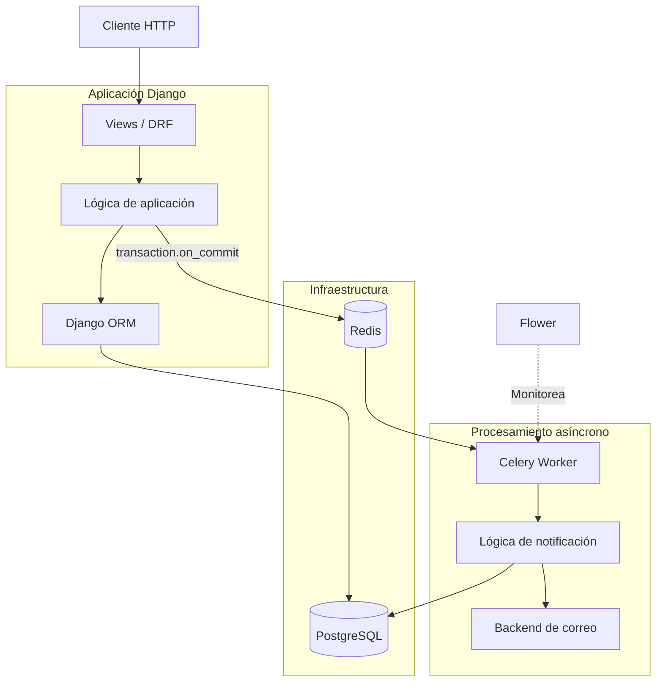

# Arquitectura — Event-Driven Notifications

## 1. Visión general

Event-Driven Notifications es una aplicación backend desarrollada con Django REST Framework que utiliza procesamiento asíncrono para gestionar el envío de notificaciones por correo electrónico.

La aplicación sigue una arquitectura monolítica modular: las operaciones HTTP, los modelos y la lógica de aplicación forman parte del mismo proyecto Django.

El procesamiento asíncrono se ejecuta en procesos independientes mediante Celery, utilizando Redis como broker de mensajes.

La arquitectura busca separar las operaciones de persistencia de las tareas externas que pueden tardar más tiempo en completarse.

## 2. Componentes principales

### Django REST Framework

Es la capa de entrada de la aplicación.

Sus responsabilidades incluyen:

- Recibir solicitudes HTTP.
- Validar los datos de entrada.
- Ejecutar la lógica correspondiente al registro de clientes.
- Persistir información en PostgreSQL.
- Coordinar la publicación de tareas asíncronas.

### PostgreSQL

Es la base de datos relacional utilizada para almacenar la información de la aplicación.

Entre los datos gestionados se encuentran los registros de clientes y los estados relacionados con el procesamiento de notificaciones.

### Celery

Es el sistema encargado de ejecutar las tareas asíncronas.

El worker consume las tareas publicadas y ejecuta la lógica de procesamiento sin bloquear la solicitud HTTP original.

### Redis

Actúa como broker de mensajes entre la aplicación Django y los workers de Celery.

La aplicación publica las tareas y Redis permite que los workers las reciban para su ejecución.

### Flower

Proporciona una interfaz de monitoreo para visualizar la actividad de Celery y consultar información sobre las tareas.

Flower facilita la observación del procesamiento, pero no reemplaza un sistema completo de logging, métricas y alertas.

## 3. Diagrama de arquitectura

## 4. Flujo de procesamiento

### 4.1 Registro de un cliente

1. El cliente realiza una solicitud HTTP.
2. Django REST Framework recibe y valida los datos.
3. La aplicación inicia la operación de persistencia.
4. PostgreSQL almacena el registro.
5. Una vez confirmada la transacción, se publica la tarea de notificación mediante `transaction.on_commit()`.

El uso de `on_commit()` evita que la tarea se publique antes de que la transacción que creó el registro haya sido confirmada.

Esto es importante porque un worker podría intentar consultar un registro que todavía no es visible fuera de la transacción original.

### 4.2 Publicación y ejecución de tareas

Una vez publicada, la tarea queda disponible en Redis.

El worker de Celery consume el mensaje y ejecuta la lógica correspondiente.

De esta manera, la solicitud HTTP no necesita permanecer abierta mientras se procesa la notificación.

### 4.3 Estados de procesamiento

El sistema contempla los siguientes estados:

| Estado | Significado |
|---|---|
| `PENDIENTE` | La notificación todavía no comenzó a procesarse. |
| `EN_PROCESO` | Un worker comenzó a ejecutar la tarea. |
| `ENVIADO` | El procesamiento registró el envío exitoso. |
| `FALLIDO` | El procesamiento terminó con un error definitivo según la lógica implementada. |

Estos estados permiten representar el ciclo de vida de una notificación.

Un aspecto importante es la recuperación de estados: si un worker se interrumpe mientras una notificación está en `EN_PROCESO`, debe existir un mecanismo que permita detectar y recuperar ese registro.

La configuración de reintentos del broker no resuelve automáticamente todos los estados persistidos en la base de datos.

## 5. Decisiones técnicas

### 5.1 Separación del procesamiento HTTP

**Decisión:** delegar el envío de notificaciones a Celery.

**Motivo:** evitar que el tiempo de respuesta de la API dependa de la duración de una operación externa.

**Trade-off:** se agrega complejidad operativa, ya que es necesario gestionar workers, colas, errores y estados de procesamiento.

### 5.2 Uso de `transaction.on_commit()`

**Decisión:** publicar la tarea después de confirmar la transacción de base de datos.

**Motivo:** evitar que un worker procese información que todavía no fue confirmada en PostgreSQL.

**Trade-off:** `on_commit()` evita publicar antes del commit, pero no garantiza por sí solo que el mensaje llegue al broker si Redis no está disponible en ese momento. Para garantías más fuertes de publicación se podría evaluar un patrón Outbox.

### 5.3 Confirmación tardía de tareas

**Decisión:** utilizar configuraciones de Celery como `acks_late` y `task_reject_on_worker_lost`.

**Motivo:** reducir el riesgo de perder una tarea cuando un worker se interrumpe durante su ejecución.

**Trade-off:** una tarea puede volver a ejecutarse después de una interrupción. Por lo tanto, la lógica debe contemplar ejecuciones repetidas.

### 5.4 Reintentos con backoff exponencial

**Decisión:** aplicar reintentos ante determinados errores transitorios.

**Motivo:** permitir que el sistema vuelva a intentar una operación cuando una dependencia externa presenta un problema temporal.

**Trade-off:** los reintentos no resuelven errores permanentes y deben limitarse para evitar ejecuciones innecesarias.

### 5.5 Control de duplicados

**Decisión actual:** consultar el estado persistido antes de ejecutar nuevamente el envío.

**Motivo:** evitar repetir operaciones que ya fueron registradas como completadas.

**Limitación:** un booleano o un estado persistido no garantizan idempotencia completa frente a fallos entre el envío externo y la actualización de PostgreSQL.

Por ejemplo:

1. El worker envía el correo.
2. El proceso se interrumpe antes de guardar el estado `ENVIADO`.
3. Celery vuelve a ejecutar la tarea.
4. La aplicación puede intentar enviar nuevamente el correo.

Este escenario demuestra por qué no se debe confundir la prevención básica de duplicados con una garantía de entrega exactamente una vez.

## 6. Manejo de fallos

La arquitectura contempla fallos posibles en diferentes puntos:

| Componente | Posible fallo | Consideración |
|---|---|---|
| PostgreSQL | Error de persistencia | La operación debe respetar la transacción. |
| Redis | Broker no disponible | La publicación de tareas puede fallar. |
| Celery Worker | Interrupción del proceso | Una tarea puede volver a ejecutarse. |
| Servicio de correo | Timeout o error de conexión | Se pueden aplicar reintentos ante errores transitorios. |
| Estado persistido | Notificación abandonada en `EN_PROCESO` | Se necesita un mecanismo de recuperación. |

## 7. Limitaciones y evolución

La implementación actual es un MVP. No ofrece garantías de entrega exactamente una vez ni una arquitectura de microservicios.

Entre las mejoras posibles se encuentran:

- Recuperación automática de notificaciones abandonadas.
- Estrategias de idempotencia más robustas.
- Integración con un proveedor SMTP o servicio externo de correo.
- Patrón Transactional Outbox para fortalecer la publicación de eventos.
- Métricas y alertas para tareas fallidas.
- Pruebas de concurrencia y recuperación ante interrupciones.
- Configuración de despliegue orientada a producción.

## 8. Conclusión

Event-Driven Notifications demuestra la integración de una API REST con un sistema de procesamiento asíncrono.

El foco técnico del proyecto está en desacoplar las solicitudes HTTP de las operaciones externas, coordinar la persistencia con la publicación de tareas y explorar los problemas de confiabilidad que aparecen cuando existen workers, brokers y servicios externos.