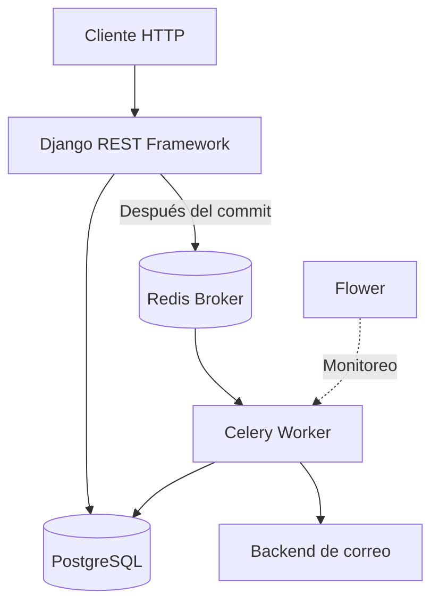

# Event-Driven Notifications

**API REST para la gestión de clientes y el procesamiento asíncrono de notificaciones por correo electrónico.**

Event-Driven Notifications es un proyecto backend desarrollado con Django REST Framework que implementa el procesamiento asíncrono de notificaciones utilizando Celery y Redis.

El objetivo principal es desacoplar el registro de clientes del envío de correos electrónicos, evitando que una operación de la API tenga que esperar a que finalice una tarea externa.

> **Estado del proyecto:** MVP desarrollado como proyecto de portfolio para explorar procesamiento asíncrono, transacciones, reintentos, manejo de errores e idempotencia en aplicaciones backend.

## Características principales

- **API REST:** gestión y registro de clientes mediante Django REST Framework.
- **Autenticación JWT:** autenticación basada en tokens utilizando SimpleJWT.
- **Procesamiento asíncrono:** delegación del envío de notificaciones a workers de Celery.
- **Redis:** utilizado como broker de mensajes para Celery.
- **Transacciones de base de datos:** uso de `transaction.atomic()` y `transaction.on_commit()` para coordinar las operaciones de persistencia con la publicación de tareas.
- **Reintentos:** manejo de determinados errores transitorios mediante la configuración de reintentos de Celery.
- **Control de estado:** seguimiento del estado de las notificaciones durante su procesamiento.
- **Control de tareas:** integración de Flower para visualizar la actividad de los workers y las tareas.
- **Docker Compose:** entorno local con los servicios necesarios para ejecutar la aplicación.

## Arquitectura

El proyecto utiliza una arquitectura monolítica modular basada en Django, complementada con procesamiento asíncrono mediante Celery.

La API, la lógica de aplicación y los modelos pertenecen al mismo proyecto Django. El worker de Celery se ejecuta como un proceso independiente y consume tareas publicadas mediante Redis.



Para conocer las responsabilidades de cada componente y los flujos de ejecución, consultá [ARCHITECTURE.md](ARCHITECTURE.md).

## Tecnologías

| Tecnología | Responsabilidad |
|---|---|
| Python | Lenguaje principal |
| Django | Framework backend |
| Django REST Framework | Construcción de la API REST |
| PostgreSQL | Persistencia de datos |
| Celery | Ejecución de tareas asíncronas |
| Redis | Broker de mensajes |
| SimpleJWT | Autenticación mediante JWT |
| Flower | Monitoreo de tareas Celery |
| Docker Compose | Entorno de desarrollo |

## Flujo general de una notificación

1. El cliente realiza una solicitud a la API para registrar un cliente.
2. Django valida los datos y persiste el registro.
3. Una vez confirmada la transacción, se publica la tarea asíncrona.
4. Redis actúa como broker y permite que un worker de Celery reciba la tarea.
5. El worker ejecuta la lógica de envío de la notificación.
6. Se actualiza el estado correspondiente según el resultado del procesamiento.

Este enfoque evita ejecutar el envío de correo directamente dentro del ciclo de vida de la solicitud HTTP.

## Manejo de errores y confiabilidad

El proyecto explora distintos mecanismos para mejorar el procesamiento de tareas asíncronas:

- Confirmación tardía de tareas mediante `acks_late`.
- Rechazo de tareas cuando se detecta la pérdida de un worker, mediante `task_reject_on_worker_lost`.
- Reintentos ante determinados errores transitorios.
- Backoff exponencial para evitar reintentos demasiado frecuentes.
- Verificación del estado de una notificación antes de intentar procesarla nuevamente.

Estos mecanismos ayudan a gestionar fallos, pero no constituyen por sí solos una garantía de entrega exactamente una vez.

La idempotencia y la recuperación de tareas interrumpidas requieren controles adicionales, especialmente cuando un worker falla después de ejecutar una operación externa pero antes de actualizar su estado.

## Instalación y ejecución

### Requisitos

- Docker
- Docker Compose
- Git

### Clonar el repositorio

```bash
git clone https://github.com/Lulipro42/EVENT_DRIVEN_NOTIFICATIONS.git

cd EVENT_DRIVEN_NOTIFICATIONS
```

### Configurar variables de entorno

Crear el archivo `.env` a partir de `.env.example`:

```bash
cp .env.example .env
```

Configurar las variables necesarias para la aplicación y los servicios.

### Iniciar los servicios

```bash
docker compose up --build
```

### Servicios disponibles

| Servicio | Dirección |
|---|---|
| API | http://localhost:8000 |
| Flower | http://localhost:5555 |

### Ejecutar tests

```bash
docker compose exec web python manage.py test
```

## Consideraciones y limitaciones actuales

Este proyecto es un MVP y no se presenta como una plataforma de notificaciones lista para producción.

Algunas consideraciones importantes:

- El envío de correos utiliza actualmente `console.EmailBackend` en el entorno revisado, por lo que los mensajes se muestran en la consola en lugar de enviarse mediante un proveedor SMTP externo.
- El estado de procesamiento debe contemplar la recuperación de notificaciones que queden en `EN_PROCESO` después de una interrupción del worker.
- La prevención de duplicados mediante un estado persistido no garantiza por sí sola la entrega exactamente una vez ante fallos entre el envío externo y la actualización de la base de datos.
- La configuración de desarrollo con Django `runserver` no representa una configuración de despliegue de producción.

## Posibles mejoras

- Implementar recuperación automática de notificaciones abandonadas.
- Fortalecer la idempotencia frente a fallos durante operaciones externas.
- Incorporar un proveedor real de correo electrónico.
- Mejorar la observabilidad y el seguimiento de fallos.
- Incorporar pruebas de concurrencia y escenarios de recuperación.
- Preparar una configuración específica para producción.

## Objetivo del proyecto

Este proyecto busca demostrar conocimientos prácticos de backend engineering mediante el diseño de una API REST que integra persistencia relacional y procesamiento asíncrono, prestando especial atención a las transacciones, los reintentos, los estados de procesamiento y el manejo de fallos.